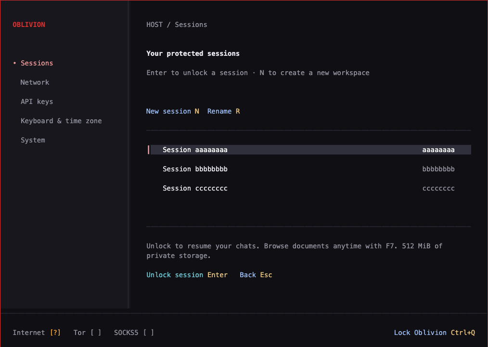

<p align="center">
  
</p>

<h1 align="center">A privacy-first live OS for conversations, research, documents and code</h1>

<p align="center">
  Boot Oblivion on supported hardware or in a virtual machine.<br>
  Work inside isolated, encrypted sessions—then lock them and leave the disposable runtime behind.
</p>

<p align="center">
  <a href="https://github.com/exploita-ai/oblivion/actions/workflows/oblivion-check.yml"></a>
  <a href="https://github.com/exploita-ai/oblivion/actions/workflows/oblivion-release.yml"></a>
  <a href="LICENSE"></a>
  <a href="#project-status"></a>
  
  <a href="https://github.com/exploita-ai/oblivion/stargazers"></a>
</p>

<p align="center">
  <a href="#download-oblivion">Download</a> ·
  <a href="#quick-start">Quick start</a> ·
  <a href="#in-the-development-build">Features</a> ·
  <a href="#why-oblivion">Why Oblivion</a> ·
  <a href="#privacy-model">Privacy</a> ·
  <a href="#where-oblivion-runs">Platforms</a> ·
  <a href="#build-from-source">Build</a> ·
  <a href="#join-the-project">Contribute</a>
</p>

---

Oblivion is a minimal Debian live operating system built around an
[OpenCode](https://github.com/anomalyco/opencode)-derived agent. Each persistent
session gets its own VM, LUKS2-encrypted volume, conversations and document
workspace. The live host is disposable, while remote model traffic is routed
through a dedicated Tor or SOCKS5 gateway with no direct fallback.

Use Oblivion to talk, investigate, write, work with documents, or let the full
coding agent operate on files you explicitly place inside an isolated workspace.

> [!WARNING]
> Oblivion is early-beta research software. It has not received an independent security audit. Public images are experimental pre-releases, not a promise of anonymity or a safe place for irreplaceable secrets.

## Download Oblivion

The current public build is
[`v0.1.0-beta.1`](https://github.com/exploita-ai/oblivion/releases/tag/v0.1.0-beta.1).
It predates the operational features described below. For those features, build
the current source; a passing branch image build does not publish a new release
or update an existing installation.

| Image               | Choose it for                                    | Download                                                                                                                                                                                                                                 |
| ------------------- | ------------------------------------------------ | ---------------------------------------------------------------------------------------------------------------------------------------------------------------------------------------------------------------------------------------- |
| `amd64` / `x86_64`  | 64-bit Intel or AMD PCs and x86 virtual machines | [ISO](https://github.com/exploita-ai/oblivion/releases/download/v0.1.0-beta.1/oblivion-v0.1.0-beta.1-amd64.iso) · [SHA-256](https://github.com/exploita-ai/oblivion/releases/download/v0.1.0-beta.1/oblivion-v0.1.0-beta.1-amd64.sha256) |
| `arm64` / `aarch64` | Apple Silicon M3+ with UTM and other ARM64 hosts | [ISO](https://github.com/exploita-ai/oblivion/releases/download/v0.1.0-beta.1/oblivion-v0.1.0-beta.1-arm64.iso) · [SHA-256](https://github.com/exploita-ai/oblivion/releases/download/v0.1.0-beta.1/oblivion-v0.1.0-beta.1-arm64.sha256) |

Download the matching checksum next to the ISO, then verify it before booting:

```sh
# Linux
sha256sum --check oblivion-v0.1.0-beta.1-amd64.sha256

# macOS
shasum -a 256 --check oblivion-v0.1.0-beta.1-arm64.sha256
```

Windows users can run `certutil -hashfile <image.iso> SHA256` and compare the
result with the downloaded checksum file. These hashes detect a damaged or
incomplete download; signed release provenance is not available yet.

## Quick start

1. Download the image matching your CPU and verify its SHA-256 checksum.
2. For direct boot, write the ISO to a dedicated writable drive with a trusted
   image writer. This erases the selected drive.
3. For a VM, turn the ISO into a larger writable raw disk with the repository's
   [Python helper](docs/DEVELOPMENT.md#apple-silicon-with-utm). A read-only
   virtual DVD cannot persist vaults.
4. Enable VT-x/AMD-V or nested virtualization and boot the writable image in
   UEFI mode.
5. Follow the first-run setup to create the general encrypted vault, then create
   a protected or ephemeral session.

Use the [VM guide](docs/DEVELOPMENT.md#run-from-a-virtual-machine) for UTM,
QEMU/KVM and VirtualBox. Running inside a VM is convenient for evaluation, but
the outer OS and hypervisor can observe input, display, memory and virtual disk.

### Working in a source build

Create or unlock Oblivion, configure your connection and provider key, then
create a named protected session. One session can contain several chats; all
its chats and terminals share that session's documents.

| Control                  | Action                                                                   |
| ------------------------ | ------------------------------------------------------------------------ |
| `F6`                     | Chat                                                                     |
| `F7`                     | Documents, imports, exports and sharing                                  |
| `F8`                     | Terminal and session processes                                           |
| `Ctrl+Q`                 | Confirm session closure and locking; lock Oblivion from the host manager |
| `/new` · `/resume`       | Create or resume a chat inside the current protected session             |
| `/exit` · `/quit` · `/q` | Request closure of the protected session                                 |

Documents and Terminal work offline without a provider key. Switching views
keeps the active VM and its work running. Starting chat from an offline VM
restarts the guest on the same unlocked volume; locking stops its processes.
Use the explicit import/export flow to move files across the session boundary.

## In the development build

These features are implemented in the current source on `main` and `dev`.
They are undergoing candidate qualification and are **not all included in
the published `v0.1.0-beta.1` ISO**.

| Feature                          | What you can do                                                                                                                                                                 |
| -------------------------------- | ------------------------------------------------------------------------------------------------------------------------------------------------------------------------------- |
| **Protected sessions**           | Name a session, keep multiple chats and shared documents in its own encrypted volume, close it and reopen its history.                                                          |
| **Session terminal**             | Run guest-only shells, manage terminal windows and inspect processes. Includes curl, Git/ripgrep, jq, SQLite, Python/venv, Node/npm, archive and document tools.                |
| **Documents**                    | Browse `workspace` and `imports`; approve file/folder imports and exports through isolated media VMs, with manifests, hashes, progress and recovery.                            |
| **Conversation exports**         | Save settled messages as Markdown or OpenCode JSON inside the encrypted workspace, then export the selected transcript.                                                         |
| **Encrypted session backups**    | Back up a closed session and restore an independent copy with its chats and documents. The original session password is required; host settings and provider keys are excluded. |
| **OnionShare**                   | Receive files into a private intake, review them before import, share selected documents, or publish a closed encrypted backup through a separate Tor transfer path.            |
| **Provider keys and networking** | Keep multiple encrypted keys, select a global default or an override for one opening, and route session traffic through Tor or an explicit SOCKS5 proxy.                        |
| **Host/guest text clipboard**    | Explicit text copy/paste in UTM; the amd64 image also packages the selected VirtualBox clipboard client. No shared folders or clipboard file transfers.                         |
| **Diagnostics**                  | Export an allowlisted report for troubleshooting, with a review step before sending it outside the session.                                                                     |

UTM text copy/paste has been tested in both directions. VirtualBox clipboard
acceptance, full large-backup transfer over public Tor, supported-candidate
hardware tests and release hardening remain open. See the
[implementation progress and acceptance gates](docs/STATUS.md#implementation-progress-2026-10-28).

<p align="center">
  
</p>

## Why Oblivion

Ordinary agents can leave conversations, logs, temporary files, credentials and
working copies across the host filesystem. Oblivion changes that boundary. On a
direct bare-metal boot, the installed OS is not running; the live system is
disposable; and every protected session owns an encrypted workspace.

| Boundary             | What Oblivion does                                                         |
| -------------------- | -------------------------------------------------------------------------- |
| **At rest**          | Separate LUKS2 volume and password for every persistent session            |
| **While running**    | Read-only Debian base with runtime and temporary paths in RAM              |
| **Between sessions** | One open volume and one session VM at a time; no shared session filesystem |
| **On the network**   | Dedicated gateway VM with Tor or explicit SOCKS5 and no direct fallback    |
| **For documents**    | Offline access without a network device, API key or agent process          |

The current cloud mode sends the context you approve to the configured
provider. This beta focuses on remote APIs and is not air-gapped; local
inference is deferred.

## Architecture

```text
Oblivion live OS (bare metal or supported VM)
└── minimal read-only Debian base
    ├── tmpfs runtime (discarded on shutdown)
    ├── general LUKS2 vault — settings and API keys
    ├── Oblivion manager
    ├── isolated gateway VM — Tor or explicit SOCKS5
    ├── isolated media and OnionShare transfer VMs — started for approved operations
    └── one active protected session
        ├── independent LUKS2 volume
        └── session VM
            ├── OpenCode-derived agent
            ├── shared documents for that session
            ├── guest terminal and processes
            └── multiple encrypted conversations
```

Documents mode starts the session VM without a network device, provider token
or agent process. Starting a chat reuses the unlocked session volume and starts
the networked VM. The host sees control messages and file metadata; it does not
mount the session filesystem. See the maintained
[architecture document](docs/ARCHITECTURE.md) for the complete boundary model.

## Privacy model

- The general encrypted vault stores host preferences and API keys.
- Every persistent session has a different LUKS2 volume and password.
- Ephemeral sessions keep working state in RAM and do not intentionally modify
  persistent storage.
- Runtime paths and temporary files live on tmpfs in the live system.
- The gateway mediates session egress through Tor or a configured SOCKS5 proxy;
  direct access is deny-by-default.
- The gateway uses the provider key. The session receives a revocable
  capability for its opening, and closing revokes that access.
- The production profile disables agent logs, telemetry, update checks,
  provider discovery, crash dumps and project-level configuration loading.

Proxied destination names are resolved through the selected transport. Direct
session DNS, UDP/QUIC and IPv6 bypasses are blocked; unsupported traffic fails
instead of taking a direct route. Host network setup still needs local traffic
such as DHCP and Wi-Fi authentication. These controls govern Oblivion, not the
surrounding OS when it runs as a guest.

These are implementation goals backed by automated and VM-level tests, not a
formal proof. Read [SECURITY.md](SECURITY.md) before using sensitive data.

## Tor and remote providers

Tor is the default remote route. It hides the source network from the model
endpoint, but it does **not** hide prompts, selected documents, tool results or
responses from the provider processing them. HTTPS protects traffic from Tor
exit relays. Tor may start slowly and some destinations block exit relays.

| Provider                                    | Integration       | Oblivion policy                                                                                              |
| ------------------------------------------- | ----------------- | ------------------------------------------------------------------------------------------------------------ |
| [Abliteration.ai](https://abliteration.ai/) | Native            | Provider publishes zero-retention handling for core API inference                                            |
| [Refuseless](https://refuseless.com/)       | OpenAI-compatible | Provider says prompts and outputs are not saved; upstream handling can vary                                  |
| [OpenRouter](https://openrouter.ai/)        | Native            | `zdr: true`, data collection denied and fallback disabled; requests fail closed without an eligible endpoint |

The selected provider still processes the submitted content. Oblivion can
enforce routing but cannot independently prove a provider's retention claims.
Read [provider privacy and routing details](docs/PROVIDERS.md) before choosing a
remote service.

## What Oblivion cannot protect

- Cloud providers see the content deliberately sent to them.
- Data is plaintext in RAM while a vault or session is unlocked.
- Compromised firmware, kernel, hypervisor, keyboard, display or physical
  hardware can observe an active session.
- Exported files inherit the security of their destination.
- Development images contain diagnostics deliberately absent from releases.

## Where Oblivion runs

When Oblivion runs inside another VM, full sessions require nested hardware
virtualization for its gateway, session and transfer VMs. Bare-metal live boot
requires ordinary hardware virtualization. There is no software-emulation
fallback in the production profile.

| Host                                                        | CPU                                         | Image          | Current support                                 |
| ----------------------------------------------------------- | ------------------------------------------- | -------------- | ----------------------------------------------- |
| Direct PC boot                                              | Intel/AMD 64-bit with VT-x/AMD-V            | `amd64`        | **Primary target; tested on physical hardware** |
| Linux + QEMU/KVM                                            | `x86_64` or `aarch64` with nested KVM       | matching image | Development/evaluation target                   |
| Windows + VirtualBox                                        | Intel/AMD 64-bit with nested virtualization | `amd64`        | Supported design; broader validation pending    |
| Apple Silicon + UTM Apple Virtualization                    | M3+, macOS 15+                              | `arm64`        | Validated on M4 Pro                             |
| Apple Silicon M1/M2                                         | ARM64                                       | `arm64`        | Manager may boot; full sessions unsupported     |
| 32-bit systems or hypervisors without nested virtualization | —                                           | —              | Unsupported                                     |

### Practical requirements

The published beta ISO is about 1.2 GB. Source builds include additional tools
and transfer components, so their image and RAM costs differ. The general
vault defaults to 2 GiB, a new session reserves 512 MiB inside it, and the
session plus model gateway allocate about 1.8 GiB of guest memory. OnionShare
starts additional VMs; its full candidate resource profile is still being qualified.

| Resource                  | Minimum for the current beta     | Recommended                                                  |
| ------------------------- | -------------------------------- | ------------------------------------------------------------ |
| Writable boot disk        | 4 GB for the published base beta | 16 GB or more for development builds, sessions and documents |
| System or outer-VM memory | 4 GB for the base chat profile   | 8 GiB for the expanded operational profile                   |
| CPU                       | 64-bit, virtualization, 2 cores  | 4 cores for smoother nested guests                           |
| Firmware                  | UEFI; Secure Boot disabled       | Hardware virtualization enabled                              |

Direct boot currently targets Intel/AMD PCs. The persistence implementation
uses free space after the read-only live image. In a VM, expose the prepared
raw disk as writable storage and disable shared folders and host-disk
passthrough. Development images now include optional host/guest text clipboard
support; see the [UTM and VirtualBox setup guide](docs/DEVELOPMENT.md#text-copypaste-in-a-vm).
Copied text is deliberately shared with the outer OS. A Debian-supported
Ethernet or Wi-Fi adapter is required for remote inference.

## Next: qualify the operational beta

The operational features above are implemented in source. The remaining work
is to qualify them together on the actual candidate: complete public Tor
backup transfers, physical-media failures, supported VM profiles, upgrades,
rollback and independent user testing. Component tests and successful ISO
builds are distinct from full candidate acceptance. Follow the
[ordered milestones and acceptance gates](docs/STATUS.md#ordered-milestones).

Keep one Debian-based product: boot it directly on a qualified PC or run it as
the host VM in a qualified virtualizer. Retain the existing LUKS storage,
controller and gateway/session/transfer VMs. The native application port and
removal of the outer Debian VM are no longer active roadmap items.

The virtualized path needs a tested image/setup profile, persistent virtual
disk and actual nested-virtualization support. Qualify each host and hypervisor
combination through full session tests, not just a booting manager. Debian's
volatile runtime cannot prevent the outer host from saving unlocked VM memory;
virtualized use has a different retention boundary from physical live boot.

Local inference, llama.cpp, model acquisition, GPU support and DGX Spark work
are deferred. Remote APIs are not air-gapped: the provider processes submitted
context, and the trusted host can observe active data.
See the [beta scope](docs/STATUS.md#remote-api-beta-scope) and
[architecture and delivery plan](docs/ARCHITECTURE.md#remote-api-beta-plan).

## Project status

`v0.1.0-beta.1` is the first public pre-release. Both `amd64` and `arm64`
images are built and verified by GitHub Actions, encrypted persistence and a
real provider response have been tested on physical amd64 hardware, and nested
ARM sessions have been validated in UTM on M4 Pro.

Current source contains the expanded operational feature set. GitHub Actions
checks the source and disposable VM laboratories and builds both image
architectures. The badges above reflect live workflow results; development
features reach users through a separately qualified release.

Hardening is still in progress: reproducible signed provenance, a minimal Debian
package audit, broader hardware coverage and an independent security review are
not complete. See [current status and limitations](docs/STATUS.md).

## Build from source

Development requires macOS or Linux, [Bun 1.4.4](https://bun.sh), Docker with
Buildx, Python 3 and space for Debian and VM images. Repeated builds can use
tens of gigabytes for compiler caches, guest roots and ISO exports; check free
space in both the host filesystem and Docker's storage.

```sh
git clone https://github.com/exploita-ai/oblivion.git
cd oblivion
bun install --frozen-lockfile --os '*' --cpu '*' --libc '*'
bun run check

# Intel/AMD 64-bit
bun run build:iso

# ARM64
OBLIVION_ARCH=arm64 bun run build:iso
```

Build output stays under ignored `artifacts/`. Development targets `dev`; only
reviewed release candidates reach `main`, and accepted `v*` tags publish both
architectures with checksums. Full build, VM and release instructions live in
[docs/DEVELOPMENT.md](docs/DEVELOPMENT.md).

## Repository map

- `packages/oblivion-host` — encrypted storage, VM lifecycle and transfers.
- `packages/oblivion-gateway` — Tor/SOCKS5 egress and firewall policy.
- `packages/oblivion-manager` — full-screen host TUI.
- `packages/oblivion-transfer` — bounded import/export operations.
- `packages/oblivion-onion` — isolated OnionShare adapter and guest profile.
- `packages/oblivion-clipboard` — text-only Wayland/SPICE clipboard adapter.
- `packages/cli`, `packages/tui`, `packages/core` and related packages — the
  retained OpenCode agent runtime.
- `script/oblivion` — image construction and security laboratories.

The repository excludes OpenCode's web and desktop apps, hosted services,
deployment infrastructure, telemetry and upstream marketing packages.

## Join the project

Contributions are welcome across the TUI, minimal Debian image, isolation
boundary, network gateway, builds, hardware support, documentation and testing.
Priorities include:

- completing the Debian package, service, binary and host-egress audit;
- reproducible images, signed checksums and provenance;
- remote-API routing, credential isolation and Tor/SOCKS5 failure tests;
- multi-chat persistence, transfer recovery and safe upgrades;
- tested virtual-machine profiles, nested startup checks and host-integration boundaries;
- broader Wi-Fi, graphics, keyboard, UEFI and virtualization coverage;
- an independent security review.

Read [CONTRIBUTING.md](CONTRIBUTING.md), explore the
[architecture](docs/ARCHITECTURE.md), open focused issues for bugs and hardware
reports, and report vulnerabilities privately as described in
[SECURITY.md](SECURITY.md).

If the mission resonates with you, star the repository and help test Oblivion
on real hardware.

## OpenCode attribution

Oblivion is an independent project derived from OpenCode v2 and is not
affiliated with or endorsed by the OpenCode team. The retained agent code
remains under its MIT license. See [NOTICE](NOTICE) and [LICENSE](LICENSE).

## License

The main repository code uses MIT; copyright notices for OpenCode and Oblivion
are preserved in [LICENSE](LICENSE). The separate OnionShare adapter uses
[GPL-3.0-or-later](packages/oblivion-onion/LICENSE). Image builds retain the
licenses and pinned source inventory of their bundled third-party components.
The Debian SPICE broker and the selected VirtualBox clipboard client retain
their upstream licenses and run separately from the manager. Their version,
source and checksum records ship with the image.
